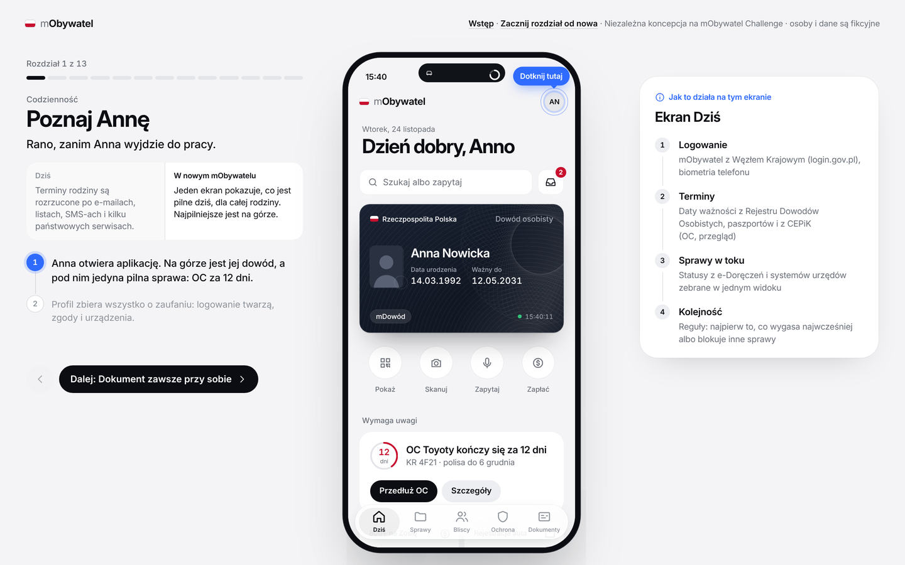

# mObywatel Razem

A clickable prototype of a new mObywatel, Poland's government app, made for the [mObywatel Challenge](https://mobywatel.ai/). This is an independent concept and not the official mObywatel app. Every person and record in it is made up.

**Live prototype:** https://metuan.github.io/mobywatel-challenge/



## What's inside

The prototype follows one week in the life of the Nowicki family across 13 chapters. They cover an ID on the phone, moving house, the car, a new baby, a cardiology appointment, a letter from the tax office, an RCB air-raid alert, reporting damage afterwards, a simplified mode for an elderly father, a shared family calendar, signing a citizens' bill, and control over your own data. Each chapter shows how the task works today and how it would work in the new app. A "Dotknij tutaj" (tap here) hint walks the visitor through each step.

On every screen, a "Jak to działa" (how it works) panel explains which public systems the step relies on, and which of them already exist and which still need to be built.

The app itself is in Polish, because it is a Polish public service.


## Getting started

You need Node.js 22 (the version is pinned in `.nvmrc`).

```bash
npm ci
npm run dev        # dev server with hot reload
npm run build      # dist/index.html, one self-contained file
npm run preview    # serve the production build
```

The build is a single HTML file with the code and styles inlined. It runs on GitHub Pages, straight from disk, and without a server.

| Script                | What it does                                                        |
| --------------------- | ------------------------------------------------------------------- |
| `npm run typecheck`   | TypeScript in `strict` mode                                         |
| `npm run lint`        | ESLint for code and Stylelint for styles                            |
| `npm run format`      | Prettier                                                            |
| `npm test`            | unit tests (Vitest)                                                 |
| `npm run test:e2e`    | Playwright plays the whole story on desktop and phone sizes         |
| `npm run test:visual` | screenshots of all 82 screens, desktop and phone, against baselines |
| `npm run check`       | everything above except e2e and visual, plus a build                |

## Stack

- **React 19 and TypeScript** (`strict`), built by **Vite** into one self-contained HTML file.
- **Tailwind CSS 4** for all styling. Classes sit on the element they style, and colours use theme names (`text-ink-2`, `bg-fill`, `bg-signal-blue`) mapped onto the design tokens in `src/styles/theme.css`.
- **shadcn/ui conventions** for the component library in `src/components/ui`: each component is a small file you own, styled with Tailwind, varied with `class-variance-authority`, merged with `cn()` (clsx + tailwind-merge), and marked with a `data-slot` attribute.
- **Radix primitives** under the interactive parts: the bottom sheet is a Radix Dialog (focus trap, Escape, labelled), switches are Radix Switch, and segmented controls are a Radix ToggleGroup.

| Component                                                             | What it is                                                             |
| --------------------------------------------------------------------- | ---------------------------------------------------------------------- |
| `Button`, `Actions`                                                   | pill buttons in six variants, and the stack or row they sit in         |
| `Pill`, `Chip`                                                        | inline buttons that size to their label                                |
| `Display`, `Title`, `Subtitle`, `Lead`, `Eyebrow`, `Muted`, `Caption` | the type scale                                                         |
| `Card`, `Badge`, `Note`                                               | surfaces, status badges, notes with an icon and a tone                 |
| `List`, `ListRow*`, `ListItem*`, `Field*`                             | grouped lists with hairline dividers, rows, and label and value fields |
| `Switch`, `Segmented`, `Sheet`                                        | the Radix-based controls                                               |

## Project structure

```
src/
  main.tsx             entry point: styles and mounting the app
  types.ts             AppState, Ctx (what every screen receives), sheets, toasts
  app/                 shell: App (the stage), chrome (top bar, tab bar, story bar, toast),
                       SheetHost, routes, gestures, Dynamic Island
    hooks/             navigation, story and coach marks, arrow keys, toasts, frame zoom
  components/ui/       the component library (shadcn/ui style)
  screens/             screens grouped by tab and topic
    today/ matters/ family/ safety/ docs/ profile/ trust/ money/ easy/ ...
  flows/               multi-step tasks: moving, new baby, doctor visit, letter, damage claim, signing
  story/               chapters and beats, "tap here" coach marks, intro tour, how-to answers
  tech/                content for the "how it works" panel
  ui/                  app-specific pieces: icons, illustrations, document card, controls, hooks
  lib/                 cn(), the styled() helper, browser helpers, shared-element transitions
  styles/
    index.css          cascade layers: theme, base, components, utilities
    theme.css          Tailwind theme mapped onto the design tokens
    00-tokens.css      design tokens: colour, type, elevation, motion
    global.css         what can't sit on an element: element defaults, keyframes, coach marks and tones
tests/
  unit/                story and route data consistency, search
  e2e/                 plays every chapter, renders every screen
  visual/              pixel baselines for every screen
```

## How it works

- **Screens** are React components that receive a `Ctx`. They are built from the components in `src/components/ui` and Tailwind classes, with no inline styles except computed values such as a progress width.
- **Styles** are Tailwind classes on the elements. `global.css` holds only what can't live on an element: element defaults, keyframes, the coach marks the story script adds at run time, and the tone classes chosen from data. It sits in the `base` layer, so a utility always wins over it.
- **Routes** live in the URL hash (`#move-1`, `#alert-red`). `src/app/routes.tsx` maps 82 routes to screens, so any screen can be opened from a link.
- **State** (`AppState`) only records what the visitor has done so far: a fine paid, a form signed, an appointment booked. Every screen receives a `Ctx` with navigation, state and confirmation sheets.
- **The story** is plain data in `src/story/chapters.ts`: chapters (today versus the new app) and beats, each naming the element to tap. The same data drives the side panel, the phone's story bar, the coach marks and the e2e tests.
- **Motion** respects `prefers-reduced-motion`, and every animation checks it first.

## Tests and CI

Every pull request runs through GitHub Actions: types, lint, formatting, unit tests, a build, an end-to-end test, and a screenshot test. The e2e test plays all 13 chapters at two screen sizes by tapping whatever the coach mark points at, and checks that each of the 82 screens renders without errors. The screenshot test compares every screen, on desktop and on a phone, with its baseline.

The baselines are rendered in Playwright's Linux image, so they only match a run in the same image. When a change is meant to move pixels, push a commit whose message contains `[update baselines]` (or run the "Update screenshot baselines" workflow), and the new screenshots are committed to the branch for review. To check a change locally, take your own baseline first: `VISUAL_SNAPSHOTS=.visual-local npm run test:visual -- -u`, make the change, then run the same command without `-u`.

When a change lands on `main`, `deploy.yml` builds the prototype and publishes it to GitHub Pages.

## Disclaimer

This is an independent concept made for the mObywatel Challenge. It is not affiliated with the Ministry of Digital Affairs or with the official mObywatel app. The people, addresses, numbers and documents in the prototype are fictional.
