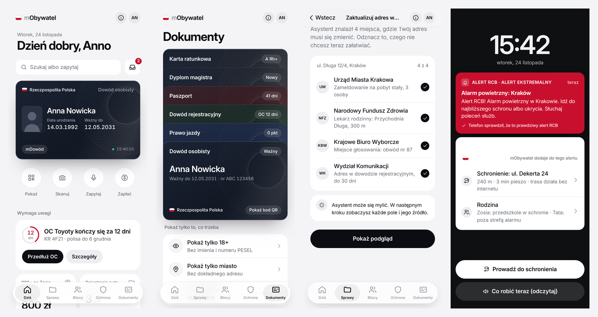

# mObywatel Razem

Klikalny prototyp nowego mObywatela na konkurs [mObywatel Challenge](https://mobywatel.ai/). Niezależna koncepcja, nie jest oficjalną aplikacją mObywatel. Wszystkie osoby i dane są fikcyjne.

**Prototyp:** https://metuan.github.io/mobywatel-challenge/


## Co jest w środku

Prototyp opowiada tydzień z życia rodziny Nowickich w 13 rozdziałach: dokument w telefonie, przeprowadzka, auto, nowe dziecko, wizyta u kardiologa, pismo z urzędu, alarm RCB, szkody po zdarzeniu, tryb prosty dla taty, kalendarz rodziny, podpis pod projektem ustawy i kontrola nad własnymi danymi. Każdy rozdział pokazuje, jak sprawa wygląda dziś i jak wyglądałaby w nowej aplikacji, a podpowiedź „Dotknij tutaj” prowadzi przez kolejne kroki.

Na każdym ekranie panel „Jak to działa” wyjaśnia, z jakich państwowych systemów korzysta dany krok i co już istnieje, a co trzeba zbudować.



## Uruchomienie

Potrzebny jest Node.js 22 (wersja jest w `.nvmrc`).

```bash
npm ci
npm run dev        # serwer deweloperski z odświeżaniem na żywo
npm run build      # dist/index.html, jeden samodzielny plik
npm run preview    # podgląd zbudowanej wersji
```

Zbudowany prototyp to jeden plik HTML z wbudowanym kodem i stylami. Działa na GitHub Pages, po otwarciu prosto z dysku i bez serwera.

| Skrypt              | Co robi                                                           |
| ------------------- | ----------------------------------------------------------------- |
| `npm run typecheck` | TypeScript w trybie `strict`                                      |
| `npm run lint`      | ESLint (kod) i Stylelint (style)                                  |
| `npm run format`    | Prettier                                                          |
| `npm test`          | testy jednostkowe (Vitest)                                        |
| `npm run test:e2e`  | Playwright: przechodzi całą opowieść na komputerze i na telefonie |
| `npm run check`     | wszystko powyżej poza e2e, plus build                             |

## Struktura

```
src/
  main.ts              wejście: style + montowanie aplikacji
  types.ts             AppState, Ctx (to, co dostaje każdy ekran), arkusze, toasty
  app/                 powłoka: App, trasy (routes.ts), gesty, Dynamic Island
  screens/             ekrany pogrupowane według zakładek i tematów
    today/ matters/ family/ safety/ docs/ profile/ trust/ money/ easy/ ...
  flows/               wieloetapowe sprawy: przeprowadzka, dziecko, wizyta, pismo, szkody, podpis
  story/               rozdziały i kroki opowieści, podpowiedzi „Dotknij tutaj”, wstęp, „Jak to zrobić?”
  tech/                treści panelu „Jak to działa”
  ui/                  wspólne komponenty: ikony, ilustracje, karta dokumentu, przyciski, hooki
  lib/                 Preact + htm, pomocnicze funkcje przeglądarki, przejścia współdzielonych elementów
  styles/
    00-tokens.css      tokeny projektu: kolory, typografia, cienie, ruch
    01-…25-*.css       kolejne warstwy stylów; kolejność importu w index.css ma znaczenie
tests/
  unit/                spójność danych opowieści i tras, wyszukiwanie
  e2e/                 przejście wszystkich rozdziałów, render każdego ekranu
```

## Jak to działa

- **Widoki** to funkcje zwracające szablony [htm](https://github.com/developit/htm) na [Preact](https://preactjs.com/). Nie ma kroku JSX, a kod ekranów jest bliski zwykłemu HTML.
- **Trasy** są w adresie (`#move-1`, `#alert-red`). `src/app/routes.ts` mapuje 82 trasy na ekrany, więc każdy ekran można otworzyć linkiem.
- **Stan** prototypu (`AppState`) pamięta tylko to, co odwiedzający już zrobił: zapłacony mandat, podpisany wniosek, umówiona wizyta. Każdy ekran dostaje `Ctx` z nawigacją, stanem i arkuszami potwierdzenia.
- **Opowieść** jest opisana danymi w `src/story/chapters.ts`: rozdziały (dziś i w nowej aplikacji) oraz kroki z elementem, który trzeba dotknąć. Ten sam opis napędza panel boczny, pasek na telefonie, podpowiedzi i testy e2e.
- **Ruch** respektuje `prefers-reduced-motion`; każda animacja najpierw to sprawdza.

## Testy i CI

Każdy pull request przechodzi przez GitHub Actions: typy, lint, formatowanie, testy jednostkowe, build oraz test e2e, który na dwóch rozmiarach ekranu przechodzi wszystkie 13 rozdziałów, dotykając tego, co wskazuje podpowiedź, i sprawdza, że każdy z 82 ekranów renderuje się bez błędów.

Po scaleniu do `main` workflow `deploy.yml` buduje prototyp i publikuje go na GitHub Pages.

## Zastrzeżenie

To niezależna koncepcja przygotowana na mObywatel Challenge. Nie jest powiązana z Ministerstwem Cyfryzacji ani z oficjalną aplikacją mObywatel. Osoby, adresy, numery i dokumenty w prototypie są zmyślone.
